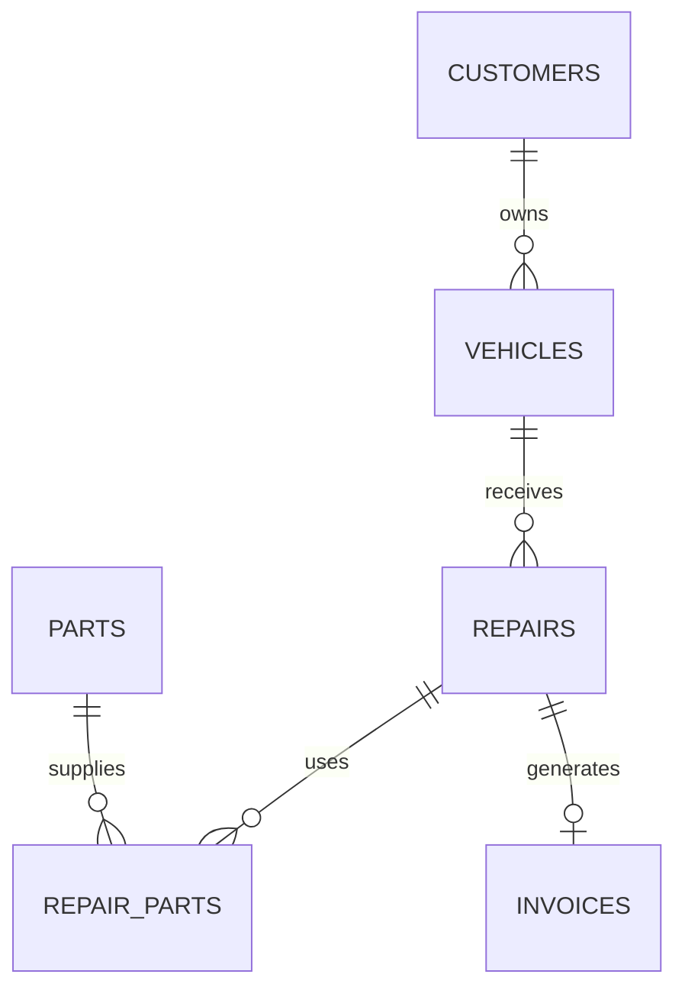

# Thiết kế cơ sở dữ liệu

Schema thực thi: [create_table.sql](../database/create_table.sql). Dùng InnoDB, utf8mb4 và khóa ngoại.

| Bảng | Nội dung và ràng buộc |
| --- | --- |
| users | Username duy nhất, mật khẩu băm, vai trò enum |
| customers | Họ tên và số điện thoại |
| vehicles | Khóa ngoại khách hàng, biển số duy nhất |
| repairs | Khóa ngoại xe, mô tả, tiền công không âm, open/completed |
| parts | Tên duy nhất, tồn kho và giá không âm |
| repair_parts | Phiếu, phụ tùng, số lượng dương, đơn giá chốt tại thời điểm dùng |
| invoices | Mỗi phiếu tối đa một hóa đơn, tổng tiền, thời điểm lập |

Xuất kho khóa phiếu và phụ tùng bằng SELECT FOR UPDATE, kiểm tra trạng thái và số lượng, trừ tồn và thêm chi tiết trong cùng transaction. Lập hóa đơn khóa phiếu và chỉ chấp nhận completed. UNIQUE(repair_id) chống lập trùng.
Tổng hóa đơn được tính bằng DECIMAL trong SQL: tiền công + tổng số lượng × đơn giá chi tiết.
Không nhận tổng tiền từ trình duyệt. Khóa ngoại ngăn tham chiếu không tồn tại; không tự động xóa dây chuyền.
Schema có thể import lại mà không xóa dữ liệu; thay đổi cấu trúc tương lai cần migration riêng.
