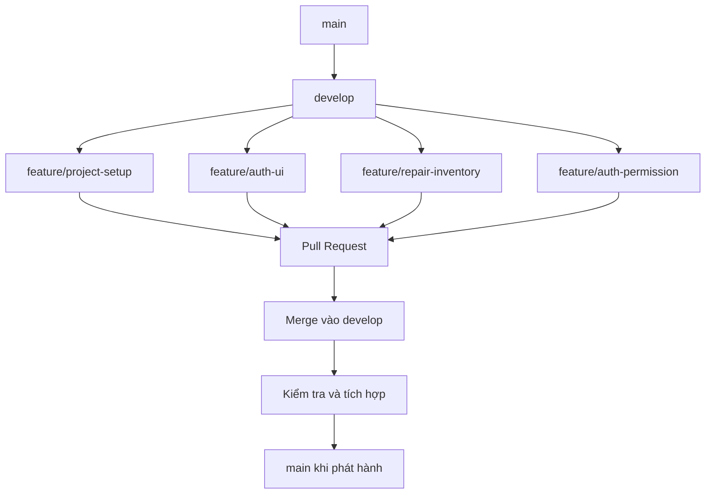

# Git Flow – Car Garage Management System

## 1. Các nhánh

- `main`: lưu phiên bản chính của dự án.
- `develop`: tích hợp các chức năng đã phát triển.
- `feature/*`: phát triển từng chức năng độc lập.

## 2. Quy trình làm việc

## 3. Quy trình Pull Request

1. Tạo nhánh feature từ `develop`.
2. Thực hiện thay đổi và commit.
3. Push nhánh lên GitHub.
4. Tạo Pull Request vào `develop`.
5. Kiểm tra thay đổi và merge.
6. Đồng bộ `develop` về máy cá nhân.